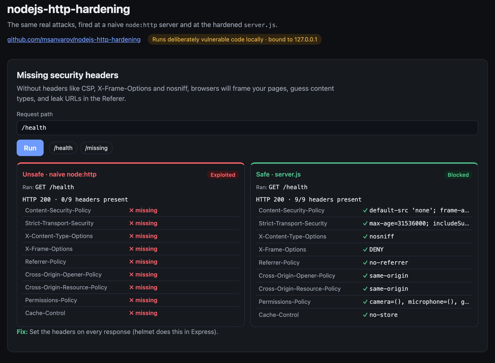
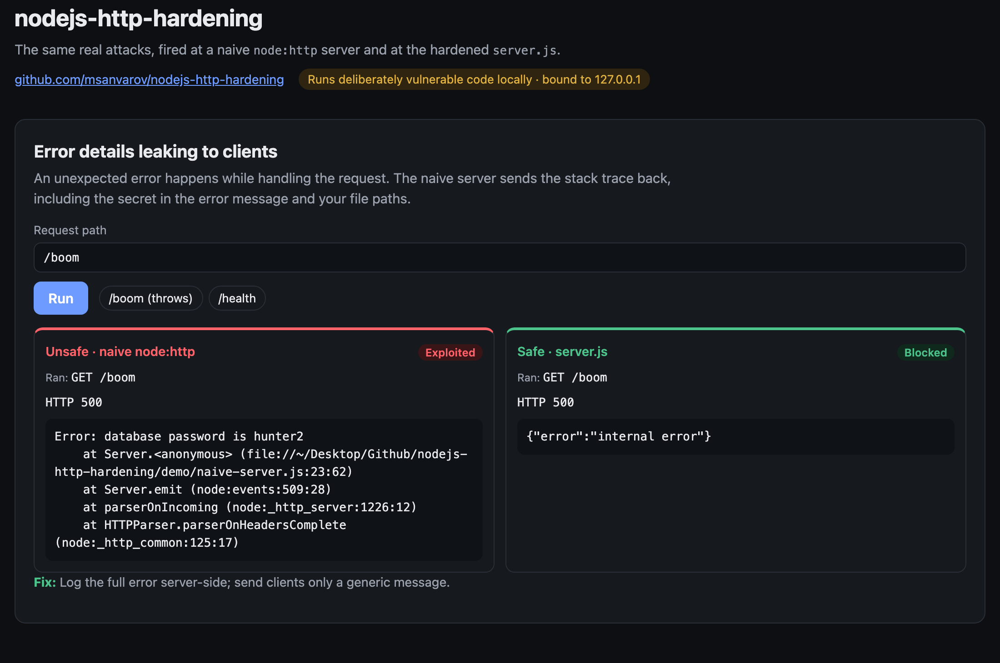
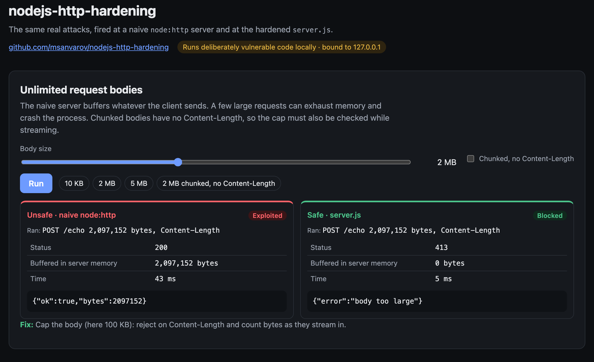
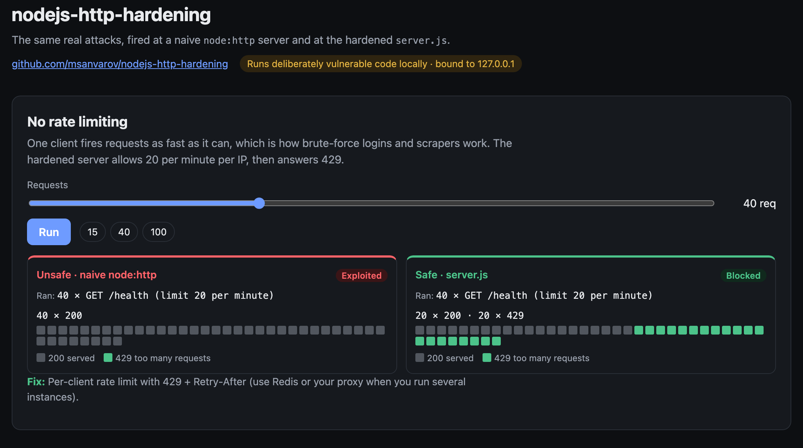
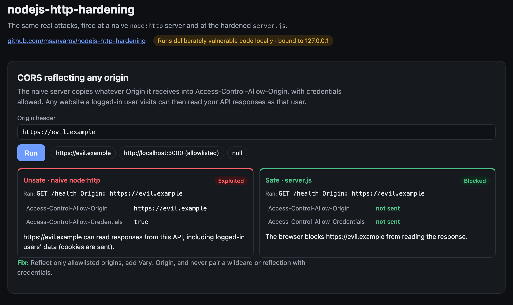
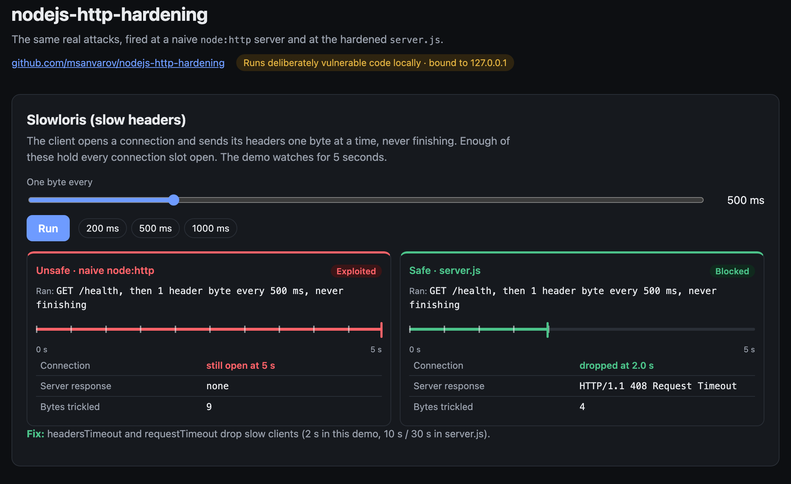

# nodejs-http-hardening

[](https://github.com/msanvarov/nodejs-http-hardening/actions/workflows/test.yml)    [](https://nodejs-http-hardening.netlify.app)

A hardened HTTP server in one file ([server.js](server.js)), built on `node:http` with no dependencies, so you can see exactly what each protection does. The same ideas map directly onto Express, Fastify, Koa, or Hono.

```bash
npm start        # http://localhost:3000
npm test         # proves each protection works
```

## Interactive demo

**Live preview: [nodejs-http-hardening.netlify.app](https://nodejs-http-hardening.netlify.app)**. It replays recorded runs, so nothing executes on that server. Run it locally to try your own payloads.

A local page that fires the same real attacks at a deliberately naive `node:http` server and at `server.js`, and shows both results side by side.

```bash
npm run demo     # http://127.0.0.1:4102
```

It only listens on 127.0.0.1 and rejects requests from other sites, because it really runs the attacks on your machine.

The hosted preview is a static build of `demo/recordings.json` (`npm run build`). Refresh the recordings with `npm run demo:record` (needs Google Chrome).

### Missing security headers

The naive server sends none of the nine headers; `server.js` sends all of them.



### Error details leaking to clients

An unexpected error returns the full stack trace and the secret in its message from the naive server, and a generic message from `server.js`.



### Unlimited request bodies

A 2 MB body is buffered whole by the naive server and rejected with 413 by `server.js`, with or without a Content-Length.



### No rate limiting

40 rapid requests all succeed against the naive server; `server.js` serves 20 and answers the rest with 429.



### CORS reflecting any origin

The naive server lets `https://evil.example` read responses with cookies attached; `server.js` sends no CORS headers to it.



### Slowloris (slow headers)

A client trickling one header byte every 500 ms keeps a naive connection open indefinitely; `server.js` drops it with 408 after 2 seconds (demo setting).



## Project layout

```text
server.js             the whole hardened server (~130 lines, node:http only)
demo/
  server.js           local demo: attacks a naive server and server.js side by side
  naive-server.js     the deliberately unprotected server it compares against
  index.html          the demo page
docs/                 screenshots of the demo
test/
  server.test.js      starts the server on a random port and attacks it
  demo.test.js        checks each demo attack and the demo's local-only guards
```

## What it does

| Risk | Mitigation in `server.js` | Express / Fastify equivalent |
| --- | --- | --- |
| Clickjacking, MIME sniffing, XSS, data leaks via Referer | Security headers on every response (CSP, HSTS, `nosniff`, `X-Frame-Options`, `Referrer-Policy`, COOP/CORP, `Permissions-Policy`) | `helmet` / `@fastify/helmet` |
| Memory exhaustion from huge bodies | Hard byte cap, checked on `Content-Length` **and** while streaming (chunked bodies have no length) | `express.json({ limit: '100kb' })` / Fastify `bodyLimit` |
| Wrong content types reaching your parser | Reject anything that is not `application/json` with 415 | `express.json({ type })` |
| Slowloris (clients trickling headers or body) | `headersTimeout`, `requestTimeout`, `keepAliveTimeout`, `maxHeadersCount` | Same `http.Server` settings on the server Express returns |
| Brute force / scraping | Per-IP fixed-window rate limit with `429` + `Retry-After` | `express-rate-limit` / `@fastify/rate-limit` |
| Cross-origin data theft | CORS reflects only allowlisted origins, adds `Vary: Origin` | `cors({ origin: [...] })` / `@fastify/cors` |
| Leaking stack traces and secrets in errors | Generic `{"error":"internal error"}` to the client, full error to server logs | A final error handler that never sends `err.stack` |

## Things this repo deliberately leaves out

- **TLS.** Terminate HTTPS at a load balancer or reverse proxy (nginx, Caddy, your cloud's LB). HSTS only matters once you serve over HTTPS.
- **Distributed rate limiting.** The limiter here is in memory, per process. With more than one instance, use Redis or rate limit at the proxy/WAF.
- **Auth and sessions.** See `nodejs-crypto-secrets` for password hashing, tokens, and signing.

## Checklist for a production Node service

- [ ] Run a supported Node LTS and patch it. Most Node security releases fix HTTP parser bugs.
- [ ] `NODE_ENV=production` (Express hides error details and enables view caching).
- [ ] `app.disable('x-powered-by')` in Express. Plain `node:http` never sends it.
- [ ] Only trust `X-Forwarded-For` when you know the proxy sets it (`app.set('trust proxy', 1)`), otherwise clients can spoof their IP and dodge rate limits.
- [ ] Validate every request body against a schema (Zod, Ajv, TypeBox). Reject unknown fields.
- [ ] Cookies: `HttpOnly; Secure; SameSite=Lax` (or `Strict`). Use CSRF tokens if you rely on cookies for state-changing requests.
- [ ] Set timeouts on **outgoing** requests too (`fetch(url, { signal: AbortSignal.timeout(5000) })`). A slow upstream should not hang your server.
- [ ] Guard against SSRF: if users supply URLs you fetch, allowlist hosts and block private IP ranges (`127.0.0.0/8`, `10.0.0.0/8`, `169.254.169.254`, etc.), checking after DNS resolution.
- [ ] Run as a non-root user, with a read-only filesystem where possible.
- [ ] Handle `unhandledRejection` / `uncaughtException` by logging and exiting, then let your process manager restart. Don't keep running in an unknown state.

## Node.js security series

| Repo | Covers |
| --- | --- |
| [nodejs-injection-defense](https://github.com/msanvarov/nodejs-injection-defense) | Command, SQL, path traversal, prototype pollution, ReDoS |
| **nodejs-http-hardening** (you are here) | Headers, body limits, timeouts, rate limiting, CORS, safe errors |
| [nodejs-supply-chain-security](https://github.com/msanvarov/nodejs-supply-chain-security) | npm config, CI auditing, install-script scanning, permission model |
| [nodejs-crypto-secrets](https://github.com/msanvarov/nodejs-crypto-secrets) | Password hashing, tokens, JWTs, encryption, secrets |

## Running it

Requires Node.js 22.13 or newer. No `npm install` needed.

```bash
git clone https://github.com/msanvarov/nodejs-http-hardening.git
cd nodejs-http-hardening
npm test
```

Found a mistake or want to add an example? Issues and pull requests are welcome.

## License

[MIT](LICENSE)
